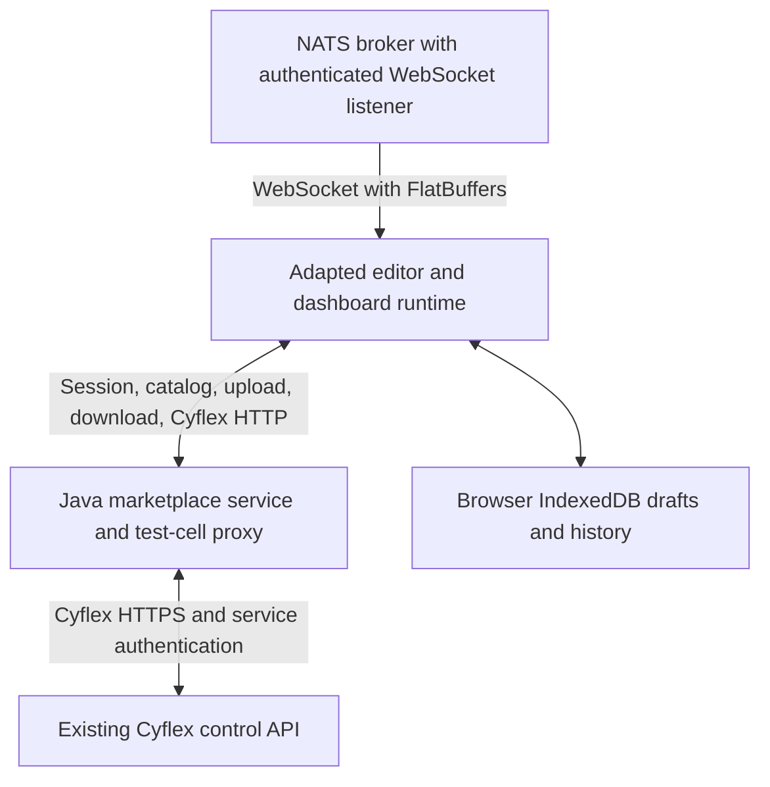

# Backend integration plan

Source review: 2026-09-28. The finished application must run without Appsmith's backend. The user confirmed that the marketplace documentation is inaccurate and that implementation source is the authority. Marketplace authoring can use the existing Java routes, while all Cyflex HTTP requests must pass through the Java test-cell proxy. Cyflex credentials already exist on the server according to the user; the checked-in Java proxy must be wired to them and its HTTPS connection repaired before live discovery or Run can work. The frontend consumes NATS directly. The standalone frontend now wires discovery and Run through these paths with controlled tests; live deployment verification is still open. The complete path and work list are in [Cyflex proxy integration audit](CYFLEX_PROXY_INTEGRATION_AUDIT.md).

Reviewed inputs:

- Frontend: `C:/Users/alexb/Desktop/asmith/app/client`
- Marketplace: `C:/Users/alexb/Downloads/backend/markerplace_backend`
- Cyflex: `C:/Users/alexb/Downloads/cyflex_backend/cyflex_backend`

This is an implementation plan based on source inspection. Neither supplied backend was built, started, or contacted during that review. No backend source was modified. The original local demo still uses Appsmith; the frontend-only `/standalone` prototype described below is a separate implementation increment.

## Recommended architecture

Fork the frontend, retain its canvas/widget/editor capabilities, and replace its platform services with browser adapters to the Java marketplace and authorized test-cell proxy. Use IndexedDB for local drafts and history and existing marketplace CRUD for shared assets. All Cyflex HTTP discovery, information, stream configuration, and keepalive requests go browser → Java proxy → selected Cyflex cell. The frontend consumes NATS live values directly through an authenticated WebSocket, decodes FlatBuffers, and manages run sessions. Appsmith's server is not part of this design.

This design depends on a working Java-to-Cyflex HTTPS route and a browser-reachable NATS WebSocket endpoint. Neither is established by the supplied source alone. A browser cannot connect to a native `nats://` TCP listener. Enabling a NATS WebSocket listener or configuring an ingress can be infrastructure work without modifying the Java application, but it is still a deployment change and must not be represented as frontend-only work. NATS does not traverse the Java proxy.

The official [NATS browser client](https://github.com/nats-io/nats.js/blob/main/runtimes.md) exposes `wsconnect`. [FlatBuffers TypeScript support](https://flatbuffers.dev/languages/typescript/) generates decoders from `.fbs` schemas; binary payloads do not require server-side conversion to JSON. Generate and bundle the decoder at build time.

## Marketplace: implemented contracts

The database seeds the three required item types: `component`, `dashboard`, and `theme`. Implemented resources support catalog CRUD, group access, item tags, ratings, thumbnails, previews, and downloads.

| Operation | Existing route / behavior |
|---|---|
| Current user | `/system/userInfo`; session resolves through the existing Azure AD SSO integration when enabled |
| Browse/create assets | `GET /marketplace/items` returns `{data, meta}`; `POST` takes multipart `itemInfo: {name, description, type}`, `content`, and a required `thumbnail` |
| Read/update/delete an asset | `/marketplace/items/{itemId}`; `PUT` takes `itemInfo: {name, description, typeId}` and replacement content |
| Download asset content | `POST /marketplace/items/{itemId}/download` returns `{downloadUrl, metadata}` and increments download count; fetch the returned URL for the content |
| Discover groups / tags | `/marketplace/groups`, `/marketplace/item-tags` |
| Locate test cells | `/system/testcells` |
| Proxy a test-cell request | `/remote/tc/{softwareId}/{path}`; the resource checks the current user's access to that cell |

Content is stored as opaque bytes at a key such as `marketplace/items/item-{id}.json`. The service does not parse or validate a dashboard, component, or theme schema. An update overwrites content at the same key. A database version column exists, but creation hardcodes version 1; this is not an implemented immutable-release workflow.

These routes are relative to the deployed application context, conventionally `/operator_display`. Individual item metadata and errors also differ from Appsmith response wrappers; implement explicit response normalization. Use a same-origin route/proxy for cookie authentication: the current wildcard CORS configuration is not a credentialed cross-origin session solution.

Individual item access checks exist, but catalog listing has its current-user permission filter commented out in [MarketplaceService](C:/Users/alexb/Downloads/backend/markerplace_backend/src/main/java/com/trplabs/cyflex/operator_display/services/MarketplaceService.java:108). The unchanged-backend design retains that limitation; client filtering cannot enforce private catalog access. Any requirement to fix that behavior requires server-side work. Development-only identity selection must remain separate from production SSO.

The `/personal-files` implementation described in the README is absent from this snapshot's resource registration, source, schemas and API specification. Referenced personal-file test classes are also absent. Do not build a client against those documented routes.

Marketplace group-filter follow-up: [the frontend/admin map](MARKETPLACE_FRONTEND_AND_ADMIN_MAP.md) traces the user's intended model of groups as marketplace filters; the complete [administration screen map](ADMIN_SCREENS_BACKEND_MAP.md) audits every admin-related Java route, its permission checks, and the backend gaps. The database and test seed have item-to-group assignments (including a Public group), and `GET /marketplace/items` accepts `group_id`. The registered Java API in this snapshot has no action to assign an item to a group, set it to public, or change `published_at`; creation leaves `published_at` null. Group-filtered browsing of existing assignments is frontend work, while making a new upload appear under a chosen group needs a verified backend action. The backend wiki describes status/visibility routes, but they are absent from this source snapshot. The Java paginator currently joins **all item filter predicates with OR**, so `group_id` combined with `type=dashboard` returns a union, not dashboards in the group. Until the backend changes this, the marketplace frontend must query `group_id` alone for group pages (search and sort may accompany it), keep the existing dashboard-only `type` query separate, and avoid combined group/type/tag facets. Client-side filtering one server page would make totals and cursors inaccurate. See [filter SQL construction](C:/Users/alexb/Downloads/backend/markerplace_backend/src/main/java/com/trplabs/cyflex/operator_display/dao/PaginationDao.java:503).

Client-owned behavior with the backend unchanged:

- Autosave private working drafts and local history in IndexedDB, scoped to account, deployment and document. These copies are browser-local, not cross-device or guaranteed durable backups. Provide file export/import and make local-versus-marketplace save status visible.
- Upload a new item or explicitly replace an existing item's content using the implemented permissions. This is distinct from assigning a group or publishing a release, which the registered Java API cannot do. A replacement overwrites content; background autosave must not accidentally become an upload.
- A new item can represent a new client-managed version. This is a convention, not server-enforced immutability or atomic optimistic concurrency. Do not promise conflict-free collaborative editing.
- Validate imported and edited documents in the client for renderer correctness. Client validation does not add a server-enforced schema restriction.
- Preserve existing ownership/group permissions. The frontend cannot broaden access or enforce new server-side rules.

Server-backed private drafts, enforced revision conflicts, immutable releases, and repaired catalog authorization remain possible future additions outside the unchanged-Java scope.

Source entry points:

- [Marketplace resources](C:/Users/alexb/Downloads/backend/markerplace_backend/src/main/java/com/trplabs/cyflex/operator_display/api/marketplace/MarketplaceResource.java)
- [Asset storage and metadata](C:/Users/alexb/Downloads/backend/markerplace_backend/src/main/java/com/trplabs/cyflex/operator_display/dao/MarketplaceItemDao.java)
- [Session resolution](C:/Users/alexb/Downloads/backend/markerplace_backend/src/main/java/com/trplabs/cyflex/operator_display/services/SessionService.java)
- [Authorized test-cell proxy entry](C:/Users/alexb/Downloads/backend/markerplace_backend/src/main/java/com/trplabs/cyflex/operator_display/api/remote/RemoteResource.java)

## Cyflex: implemented contracts

Cyflex runs a control API and a long-running NATS publisher. It aggregates the requirements of active clients. A dashboard does not need to launch a separate publisher process or create a JetStream stream.

| Operation | Contract |
|---|---|
| Cell metadata | `GET /cyflex`, selecting the representation with its vendor `Accept` header |
| Variable metadata / values | `/cyflex/variables`, with vendor media types for supported reads and writes |
| Register or replace a client's stream requirements | `POST /cyflex/streaming`, `Content-Type: streaming/json_config+input+v1`; body includes `uuid`, `variables`, and `watchers` |
| Keep a client alive | Same path, `Content-Type: streaming/json_alive+input+v1`; body contains `uuid` |
| Abandoned-client cleanup | Existing 331-second timeout, checked approximately every 1.024 seconds |
| Internal configuration | Aggregate configuration published to `ipc.streaming.config.update` |
| Live values | Core NATS publication on a shared `global.streaming.<site>.<machine-derived-hash>` subject |

Application errors can be returned in HTTP 200 JSON bodies. The adapter must inspect the response body and not equate HTTP 200 with successful registration.

The live payload is binary FlatBuffers. The default V2 schema uses the `V2FB` identifier and currently carries internal version 4. Variables include a uint64 ID, unit code, type, status/limits, and timestamped value chunks. Preserve 64-bit IDs as strings or BigInt at the JavaScript boundary. Key runtime values by cell, variable ID, and unit code, because a variable can appear in multiple units.

No HTTP unregister operation is present, and an empty variable configuration is rejected. On run exit, close the browser's subscription and stop its keepalives; accept Cyflex resource cleanup after the existing timeout. Immediate server removal would require an additional operation and is outside this design. A viewer must never stop the shared publisher to end its own run session.

The source configures HTTPS on port 8822 and applies Basic authentication. The Java proxy currently constructs an HTTP URL for that port and forwards Accept but does not supply downstream Authorization. Wire it to the credentials already provisioned on the server and repair certificate trust and the Cyflex service account's source-IP rule before live discovery or Run. Do not embed shared service credentials in the frontend. The existing Java resource performs user-to-cell access checks, but its broad path and method proxy needs an explicit distinction between read access and control actions. See the [full proxy audit](CYFLEX_PROXY_INTEGRATION_AUDIT.md).

No browser WebSocket/SSE server or marketplace-session bridge was found in the C++ source. The NATS broker itself can provide the direct browser WebSocket transport; broker configuration was not supplied. Use broker-enforced subscription permissions and browser-appropriate credentials. A user receiving a shared cell subject can inspect every value on that subject even if widgets hide some values. If access to the whole cell subject is intended, that can fit; finer access requires server/broker support.

Source entry points:

- [Control API registration](C:/Users/alexb/Downloads/cyflex_backend/cyflex_backend/src/api_server_main.cc:290)
- [Stream configuration and keepalive](C:/Users/alexb/Downloads/cyflex_backend/cyflex_backend/src/api_cyflex_streaming_resource.cc:103)
- [Client timeout](C:/Users/alexb/Downloads/cyflex_backend/cyflex_backend/inc/apiserver_clients.hh:123)
- [Configuration aggregation and expiry](C:/Users/alexb/Downloads/cyflex_backend/cyflex_backend/src/api_server_client_monitor.cc:95)
- [Binary payload schema](C:/Users/alexb/Downloads/cyflex_backend/cyflex_backend/inc/variablesV2.fbs)
- [NATS publishing loop](C:/Users/alexb/Downloads/cyflex_backend/cyflex_backend/src/nats_streaming_main.cc:457)
- [Current Java proxy](C:/Users/alexb/Downloads/backend/markerplace_backend/src/main/java/com/trplabs/cyflex/operator_display/services/CyflexProxyService.java)

## Frontend changes

Keep the existing widget definitions, canvas layout, property editing, component insertion helpers, and relevant evaluation machinery. Replace startup and persistence at explicit service boundaries rather than implementing every Appsmith HTTP endpoint on the Java server.

| Boundary | Required change |
|---|---|
| Identity and navigation | Use marketplace session/user data. Replace Appsmith signup/login, workspace shell, and permission mapping. Backend authorization remains authoritative. |
| Editor/viewer initialization | Replace consolidated Appsmith API loading with a loader for the selected dashboard document, theme, user capabilities, and stream bindings. |
| Saving | Serialize the dashboard document to an IndexedDB working copy and local history. Appsmith's layout-save API currently does more than store raw JSON and cannot simply be redirected. |
| Publishing | Upload an explicit snapshot through marketplace CRUD. Continue editing locally. Existing-item updates overwrite content; separate items can represent versions by convention. |
| Reusable components | Insert copied widget groups initially, remapping IDs/names and internal bindings. Linked components with propagated updates are additional work. |
| Themes | Convert marketplace theme data to the renderer's theme structure; remove Appsmith theme API dependencies. |
| Run mode | A browser session controller configures Cyflex, keeps the session alive, handles restart/reconnect, decodes NATS WebSocket messages, and unsubscribes/stops keepalives on exit. Editor Preview and published viewing are separate states in the current frontend. |
| Evaluation | Expose a named transient stream-data source to bindings. Batch updates and bound chart history; do not rewrite saved widget JSON on each message. |
| Unsupported platform features | Remove or explicitly disable unsupported Git, database-plugin execution, administration, and other Appsmith platform flows. |

Important dependencies are visible in [InitSagas](C:/Users/alexb/Desktop/asmith/app/client/src/sagas/InitSagas.ts:119), [AppEditorEngine](C:/Users/alexb/Desktop/asmith/app/client/src/entities/Engine/AppEditorEngine.ts), [AppViewerEngine](C:/Users/alexb/Desktop/asmith/app/client/src/entities/Engine/AppViewerEngine.ts), [PageApi.savePage](C:/Users/alexb/Desktop/asmith/app/client/src/api/PageApi.tsx:209), and [PageSagas](C:/Users/alexb/Desktop/asmith/app/client/src/ce/sagas/PageSagas.tsx:507). The current page loader expects server-migrated DSL. A standalone version must own schema compatibility and migrations instead of silently relying on Appsmith's server.

## Dashboard document contract

Define a versioned package with asset kind, schema version, renderer/schema compatibility, widget layout and properties, stream bindings, theme reference or inline theme, and pinned component dependencies. Keep live values, session UUIDs, credentials, and deployment-specific connection secrets outside published documents.

For the first implementation, retaining Appsmith-compatible widget layout inside the package minimizes renderer changes. The marketplace's opaque storage does not currently force another format. Real existing dashboard/component/theme examples are still needed before defining compatibility or migration requirements: the supplied content fixtures contain only `testContent` placeholders.

Map logical variable bindings to an authorized test cell at run time. A marketplace dashboard should remain reusable across permitted cells without embedding private network addresses or credentials.

## Implementation order and acceptance criteria

1. Wire the Java proxy to the existing server-held Cyflex credentials, repair and verify HTTPS identity, and narrow the proxy's path, method, and control permissions. Independently define the document schema, marketplace identity adapter, and local-draft format. Add one realistic fixture containing a text widget, a numeric value and a chart, a reusable group, a theme, and explicit variable/unit bindings.
2. Add a separate frontend bootstrap path that renders and edits that fixture with all Appsmith network requests blocked. This is a renderer-dependency test, not proof of backend integration.
3. Implement account-scoped IndexedDB drafts, local history, file export/import and refresh recovery. Wire catalog/download/upload to existing real authenticated marketplace APIs with their actual multipart payloads and permissions.
4. Route all browser Cyflex HTTP operations through Java and connect the direct browser NATS WebSocket transport with the generated Cyflex decoder. Prove configure, keepalive, binary decode, reconnect/reconfiguration and unsubscribe/lease expiry against a development cell/NATS environment. Verify broker permission boundaries separately from UI filtering.
5. Implement explicit marketplace uploads for dashboard snapshots, copied components, and themes. Make replacement-versus-new-item semantics visible. Do not claim that an upload is public/group-published or that client version labels are server-enforced immutable releases.
6. Verify the complete flow with Appsmith's container stopped and all other Appsmith backend access blocked: sign in through marketplace identity, download a dashboard, edit and save locally, reload the working copy, enter Run, observe real data, leave Run, upload a snapshot, and install it through the existing catalog. Assert that no Appsmith API requests are made and that every Cyflex HTTP call uses the authorized Java proxy.

Tests should cover account separation and quota/failure recovery for local drafts, exact marketplace request/response shapes, component reference remapping, theme round trips, 64-bit IDs and units, binary protocol versions, timeout/reconnect behavior, and two simultaneous viewers where one viewer leaves without disrupting the other. Server-enforced immutability and multi-user save conflicts are not supported acceptance claims under this constraint.

The Cyflex source depends on the wider Cyflex SDK/build tree, POSIX libraries, NATS and FlatBuffers tooling; it is not a standalone Windows build from this directory. Java packaging also references companion workspace resources. A reachable development deployment or the complete build environment is needed for live end-to-end verification. No substitute or mock backend should be reported as that verification.

## Implementation checkpoint — 2026-09-28

The current increments are frontend-first because no browser-accessible development NATS WebSocket URL or working Cyflex control route is available yet. `/standalone` loads a versioned example dashboard into the existing canvas and property editor. `/workspace` uses the marketplace session and catalog contract to select a dashboard, then opens it in the same editor with an account-scoped local draft. Both routes start without Appsmith's application bootstrap, and the network guard blocks Appsmith API requests. The marketplace browser test uses controlled HTTP responses; real Java behavior is still unverified.

| Plan step | Current implementation | Remaining proof or work |
|---|---|---|
| 1 | Dashboard document V1, JSON schema/runtime validation, realistic text/value/chart/group/theme/binding fixture; same-origin marketplace client; account/deployment-scoped IndexedDB draft store | Verify real marketplace identity and deployed Cyflex/NATS routes |
| 2 | `/standalone` bootstrap with canvas, property editing scoped to supported controls, Appsmith network guard, and browser edit/reload smoke; `/workspace` can open a shared item or create an independent local dashboard with a unique ID, editable name, Text/Chart/Container palette, guided Text/Chart Cyflex bindings, and optional authorized-cell variable discovery that fills a reusable logical label without saving the cell ID; `/view?itemId=…` downloads the published snapshot directly and renders it read-only. Appsmith event settings, data connection prompts, and inspect controls are hidden in integration mode, and configured widget events are rejected by document validation. | Verify authored selectors, unit codes, and documents against a real selected cell and catalog; broaden widget compatibility |
| 3 | Local revision history/restore and JSON import/export in `/standalone`; account-scoped drafts, local draft listing and direct `/workspace?draftId=…` reload, marketplace catalog/search/open UI, request adapter, copied-component insertion, and workspace orchestration | Verify identity, permissions, download, and local-draft selection against a real authenticated deployment |
| 4 | Generated FlatBuffers V2 reader with bounded layout validation; unit-aware transient binding projector; Run controller and browser bridge; marketplace control and NATS WebSocket adapters; editor and read-only viewer Run panels with authorized cell selection, variable and exact-subject resolution, Start/Stop/status/errors, and scoped transient native widget props; controlled browser Run flow with binary NATS frames and a two-viewer isolation check | Verify the actual control route, NATS WebSocket authentication and subject permissions, Cyflex timestamp conversion, and full Run flow against a development cell |
| 5 | `/workspace` has separate dashboard, component, and theme create/replace actions. Component and theme catalogs support type-filtered browse and search. Component installation copies a group, remaps widget IDs, names, variables, and bindings, and pins the downloaded content hash. Older component DSL packages (89–93) migrate through Appsmith's migrator to the current renderer version (94) before insertion. Theme application stores an inline snapshot for offline rendering. New-item uploads require a thumbnail; installs and local saves do not publish. | Verify actual upload permissions and content compatibility against real marketplace assets |
| 6 | No complete integration test yet | Run the stated end-to-end acceptance flow with a reachable backend and Appsmith stopped |

The new integration modules live under `app/client/src/integration`. All 190 focused tests pass across 22 Jest configurations, including new-dashboard creation, guided binding edits and projection, authorized-cell variable discovery, widget palette geometry, widget-outline projection, document event validation, integration property filtering, marketplace request shapes, component copying and DSL migration, theme validation and application, V2 FlatBuffers decoding from a compiler-built fixture, selected-cell metadata resolution, Cyflex control and NATS transport behavior, Run-session lifecycle, browser value projection, Run panel and viewer shell controls, workspace orchestration, catalog interactions, and transient native widget props. A browser bundle smoke check includes the generated decoder and NATS client. The standalone browser check (`app/client/scripts/verify-standalone.cjs`) passes editing, local history restore, export of unsaved edits, rejection of an imported action handler without losing current edits, valid import, refresh recovery, and blocked Appsmith API traffic. The marketplace browser check (`app/client/scripts/verify-workspace.cjs`) passes catalog opening, account isolation across a session change, local refresh recovery, and separate dashboard create/replace requests using controlled responses. The new-dashboard browser check (`app/client/scripts/verify-workspace-authoring.cjs`) passes empty-catalog creation, unique account-scoped drafts, authorized-cell discovery through controlled catalog/detail and variable-metadata responses, exact logical-label selection, Text latest and Chart history binding to a shared variable, save/reload, explicit publication with binding metadata, and a second distinct draft. It confirms that selected-cell identity and raw uint64 metadata IDs are not saved and makes no streaming, control, or NATS requests. The Run browser check (`app/client/scripts/verify-workspace-run.cjs`) uses controlled Cyflex responses and a mocked NATS WebSocket to pass cell selection, control registration, real V2 binary decoding, widget display, Stop, local save, reload without saving live values, and stopping an active Run after a binding edit. The asset browser check (`app/client/scripts/verify-workspace-assets.cjs`) passes type-filtered component/theme browse, older component migration and install, theme application, preservation of unsaved edits, local save/reload, and explicit create/replace requests. The two-viewer browser check (`app/client/scripts/verify-workspace-viewer.cjs`) proves that published snapshots bypass local drafts, both pages render live values under distinct Run IDs, and stopping one viewer does not interrupt the other. These controlled responses are frontend tests, not proof of a working deployment. The native IndexedDB check (`app/client/scripts/verify-integration-drafts.cjs`) passes account separation, revision conflicts, reload, and storage-failure recovery. Full client TypeScript checking passes. Marketplace and Cyflex deployment verification remains open. The supplied C++ source does not establish the unit of `fbChunk.utime`, so the browser bridge requires an explicit conversion once the deployment is available. The supplied Java test-cell proxy has an unresolved HTTP/HTTPS and downstream-authentication mismatch with the Cyflex source configuration. The literal Cyflex `STREAM_SUBJECT` JSON key also requires deployed-response confirmation because its SDK definition is unavailable.

The standalone editor uses Appsmith's fixed-layout canvas and widget DSL. Its editing shell now supplies Appsmith's canvas scroll parent, editor context, and drag sagas, and the palette exposes the stock draggable Text, Chart, and Container cards alongside click-to-add buttons. The standalone drag browser check (`app/client/scripts/verify-standalone-drag.cjs`) passes widget move, resize, and Text-card drop, then confirms exported layout coordinates and the added widget survive local save/reload with no Appsmith API request. JSON conversion is not part of the drag interaction.

The standalone and workspace editors now present the supported Appsmith-style workbench: a narrow navigation rail, an explorer with Widgets, Outline, and Dashboard tools modes, the fixed-layout canvas, and the native widget property pane. The Widgets mode uses Appsmith's searchable grouped widget cards, limited to supported display widgets. The Outline mode projects the live nested Redux widget tree and selects widgets into the native property pane. Live data is a right-pane tab; Run, marketplace assets, publication, and local history are in Dashboard tools. Tools remain mounted while hidden so switching panes does not stop an active Run. The header uses Appsmith design-system presentation components with local draft actions, and a bottom status bar reports local revision and API-guard diagnostics. The shell does not mount the backend-dependent AppIDE loader or route panes. The canvas stays at its saved pixel width, with visible horizontal scroll controls; the left explorer has an accessible 240–500px resize handle. The new shell browser check (`app/client/scripts/verify-workbench-shell.cjs`) passes header, palette, outline search/selection, tools/history, pane switching, canvas scrolling, keyboard and pointer explorer resizing, and zero Appsmith API requests or page errors. The updated drag, standalone, authoring, Run, and asset browser checks pass in this layout. At narrower viewport widths, Appsmith's fixed-width artboard scrolls horizontally in the center pane; scaling it with CSS would break pointer-coordinate handling. Marketplace and Cyflex deployment verification remain open.

### Frontend-only editor shell

The target is the full **supported dashboard workbench UI** without any Appsmith backend contract. The integration bootstrap and its Appsmith API guard remain in place. The implementation reuses visual components from Appsmith's design system (`IDEHeader`, `ExplorerContainer`, icons and tabs) along with `UIEntitySidebar`, `Canvas`, and `PropertyPane`. The narrow rail uses accessible native buttons with Appsmith icons because the stock `IDESidebar` buttons lack keyboard interaction. Navigation, title, widget tree, selection, local save, history, Run, asset, and publication state come from integration-owned code. The canvas viewport and explorer resize handle are also integration-owned so they preserve fixed-layout pointer coordinates.

Do not mount `AppIDELoader`, `StaticLayout`'s route panes, or the stock app header/sidebar/BottomBar as a shortcut. Their loaders and effects require Appsmith's consolidated page load, workspace and permission APIs, builder routes, Git/query/JS services, and layout-save responses. Recreating those service contracts in the browser would be more work and more fragile than composing the visual shell. Marketplace authentication/catalog and Cyflex live-data calls remain separate external integrations; an offline local draft requires neither.

The published viewer initializes the browser evaluation worker through the local editor path before mounting the page renderer. Appsmith's stock published evaluator waits for a JS-library API response from its backend; the mode switch avoids that dependency while keeping the mounted viewer read-only. The first release authors new dashboards through the integration editor without Appsmith query, JS-object, or custom-library controls. Configured widget event handlers are rejected by the document validator on import, save, and publication; ordinary display bindings remain available. Arbitrary expressions in imported JSON cannot be proven free of external references by this check. A dashboard with a marketplace theme reference resolves the current theme bytes; the unchanged backend cannot enforce its pinned revision after replacement.

The marketplace frontend now has its own `/marketplace` catalog and `/marketplace/items/:id` detail route. It uses Appsmith design-system controls and the existing Java client for group/tag options, item cards, search, cursor paging, and item metadata. The group filter sends `group_id` alone because the supplied Java paginator ORs filters; the UI clears a group when the user chooses a type or tag. Detail access handles server 403 responses. The browser check `app/client/scripts/verify-marketplace.cjs` passes against controlled Java-shaped responses and confirms zero Appsmith API requests. Real Java authorization and data remain unverified. Item create controls now use **Upload** language because the registered API has no public/published setter. The frontend/admin action map is in `MARKETPLACE_FRONTEND_AND_ADMIN_MAP.md`.

### Administration frontend checkpoint

`/admin` now has an integration-owned shell with role-aware navigation. Groups has management list, create, general details, and members screens; Users has list, detail, and a create form that reports the current Java failure; Tags has CRUD. `/marketplace/items/:id/manage` exposes content replacement, thumbnail and preview handling, tag assignment, and item deletion. Sites and Test Cells have read-only list/detail screens, and Universal Variables has catalog/detail with write forms disabled by default. `/admin/access` shows the intended group-assignment areas as disabled controls. These routes use Appsmith design-system components without starting its settings/workspace loaders. The [admin screen map](ADMIN_SCREENS_BACKEND_MAP.md) records each implemented screen and the corresponding Java gaps. The controlled `verify-admin.cjs` browser flow passes navigation, group/tag mutations, a failed user create, disabled pending actions, optional preview-request failure, mobile width, and zero Appsmith API requests. Focused admin/API route tests and full client TypeScript checking pass. All live-backend behavior still needs deployment verification.
