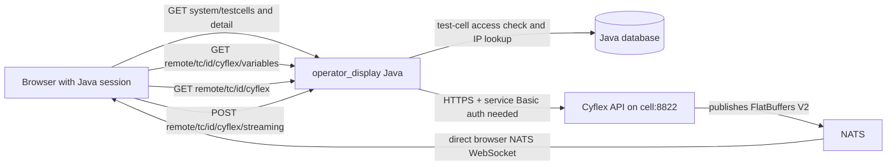

# Cyflex discovery and Run proxy path

Source audit: 2026-09-28. This traces the checked-in frontend, Java, and Cyflex source. It does not establish that a deployed proxy or broker works. The user confirmed that Cyflex credentials already exist on the server and that the frontend will consume NATS directly. The `app/client/src/integration/` frontend is earlier project code, not native Appsmith code. `operator-display-client/` now contains variable discovery, a Run controller, and direct browser NATS transport; these are verified with controlled responses and a binary fixture, not a live deployment.

## End-to-end paths

All **Cyflex HTTP** calls should use the same-origin Java route, with browser session cookies. NATS is a separate streaming protocol consumed directly in the frontend over an authenticated WebSocket; it does not pass through Java.

| Purpose | Browser request to Java | Downstream Cyflex request | Current source state |
| --- | --- | --- | --- |
| Find permitted cells | `GET /operator_display/system/testcells` | None; Java database | Java filters non-admin results to cells visible to the user. |
| Confirm a selected cell | `GET /operator_display/system/testcells/{softwareId}` | None; Java database | Java checks cell access and returns details. `softwareId` is the test-cell software configuration ID. |
| Authoring discovery | `GET /operator_display/remote/tc/{softwareId}/cyflex/variables` | `GET /cyflex/variables`, `Accept: variables/json_all+output+v1` | Java checks cell access, then proxies. The old frontend preserves raw decimal uint64 IDs and selects an exact logical label. |
| Run subject | `GET /operator_display/remote/tc/{softwareId}/cyflex` | `GET /cyflex`, `Accept: cyflex/json_info+output+v1` | Response includes a streaming subject, but the literal JSON key comes from an unavailable Cyflex SDK header and needs deployed-response confirmation. |
| Run variable resolution | Same `.../cyflex/variables` route | Same variables GET | Resolve the saved logical labels or IDs against the selected cell at Run start. |
| Register or update Run | `POST /operator_display/remote/tc/{softwareId}/cyflex/streaming` | `POST /cyflex/streaming`, `Content-Type: streaming/json_config+input+v1`, `Accept: streaming/json_config+output+v1`, body `{uuid,variables,watchers}` | Old frontend routes this through Java. Cyflex can report an `error` in an HTTP 200 JSON body. |
| Keep Run alive | Same streaming POST | `Content-Type: streaming/json_alive+input+v1`, `Accept: streaming/json_alive+output+v1`, body `{uuid}` | Old frontend sends periodic keepalives through Java; stopping unsubscribes and lets the Cyflex lease expire. |
| Receive values | No Java request | NATS publishes FlatBuffers V2 on the exact cell subject | Browser connects directly to a deployment-provided NATS WebSocket URL and subscribes to the exact authorized subject. |

### Verified source chain

- Java `WebResource.java:74-99` binds session identity and mounts `remote` and `system`; `SystemResource.java:87-112` exposes test-cell list/detail. `TestCellService.java:42-81,97-160` filters the list and checks selected-cell access.
- Java `RemoteResource.java:40-55` checks test-cell access before creating `CyFlexProxyResource.java:53-94`; the latter handles GET, POST, PUT, and DELETE. `CyflexProxyService.java:119-146,195-263` resolves the cell IP, forwards query, `Accept`, body/`Content-Type`, and the downstream status/body.
- Cyflex `api_server_main.cc:289-306` serves HTTPS on port 8822 and registers `/cyflex`, `/cyflex/variables`, and `/cyflex/streaming`. `api_cyflex_variables_resource.cc:14-93` returns variable metadata and may return an application `error`. `api_cyflex_resource.cc:41-98,385-442` supplies Run info. `api_cyflex_streaming_resource.cc:103-275,279-390` handles config and keepalive. Each route checks Basic authentication.
- Earlier frontend `VariableDiscoveryChooser.tsx:50-110` calls `MarketplaceClient.ts:278-345` and `resolveSelectedCellVariables.ts:212-278`; `MarketplaceCyflexControlTransport.ts:32-50` sends Run control through the same Java proxy. `NatsWebSocketSubscriptionTransport.ts:13-50` opens a separate browser WebSocket. These frontend paths are implementation references and controlled-test evidence, not proof of a live route.

## Backend work needed before a live connection

1. **Fix Java-to-Cyflex transport.** `CyflexProxyService.java:139-141` constructs `http://<ip>:8822/`; the checked-in Cyflex server enables SSL on 8822. Use HTTPS. Cyflex creates self-signed certificates with `cyflex.internal`/loopback SANs (`api_helpers.cc:258-292`), while Java addresses cells by database IP. Establish a trusted certificate and hostname scheme or another verified service identity; changing the scheme alone will not satisfy normal TLS validation.
2. **Wire Java to the credentials already on the server.** `CyflexProxyService.java:255-263` forwards `Accept` only and does not retrieve or send Basic credentials. Cyflex `verify_basic_auth` is called by all three routes. The supplied Java source does not show a Cyflex credential lookup, although deployment may already provide the credentials as the user confirmed. Connect the proxy to that server-side secret source and add downstream Basic authorization after checking the browser session and cell permission. `api_helpers.cc:95-188` also distinguishes certain Basic-auth users by whether the request comes from a configured local IP, so the selected identity must be permitted from the Java server's actual source IP. Keep the credentials out of dashboard documents, frontend bundles, and browser requests.
3. **Constrain the proxy contract and control permission.** Keep the per-cell permission check in `RemoteResource`. For this product, allow only the required Cyflex paths and HTTP methods, validate the cell ID and path, and set bounded connection/read timeouts and response limits. The current resource accepts arbitrary downstream paths and GET/POST/PUT/DELETE for any authorized cell. `TestCellDao.java:173-205` grants cell access to system admins or members of any assigned group; it does not distinguish discovery from control. Before the proxy uses its server-held Cyflex identity, define who may POST stream configuration and enforce that decision separately from read access. Forward only required response headers; `CyflexProxyService.java:271-282` currently copies almost every downstream header, which could expose a Cyflex authentication challenge or cookie to the browser.
4. **Make upstream failures and resource cleanup explicit.** Preserve Java-session 401/403 for browser authentication and cell permission; report Cyflex TLS, network, and service-account failures as upstream errors with useful server logs. The current catch block turns every proxy exception into a generic `operationFailed`, and its streaming response does not explicitly close the downstream JAX-RS `Response`. Close that response after copying the body, including on copy failure. Cyflex may also return a JSON `error` with HTTP 200, so the client must inspect the application payload.
5. **Verify the deployed Cyflex and NATS contracts.** Confirm the variables JSON fields and full uint64 ID behavior, the literal stream-subject key, configured units/value types, timestamp conversion for V2 frames, Java-to-Cyflex service authentication and certificate trust, and browser NATS WebSocket authentication and exact-subject permissions against a real permitted cell. The Cyflex `VariableManager::toJson()` and `jsonlabels::STREAM_SUBJECT` definitions are in unavailable external SDK code, so the checked-in source does not settle every response field.

## Frontend wiring and remaining deployment work

1. The standalone workbench now loads authorized cells through Java, requests `/cyflex/variables` only after selection, preserves uint64 IDs as decimal strings, and lets the user choose an exact logical label. Loading, search, empty, retry, and HTTP error states are present. The selected cell and raw variable ID are absent from the saved dashboard.
2. Its Run panel resolves `/cyflex` and `/cyflex/variables` through Java, then sends stream configuration and keepalives through the same proxy. The browser NATS adapter independently subscribes to the exact subject returned by Cyflex. Values remain in a transient overlay and clear on Stop or document change.
3. The deployment must provide browser-scoped NATS WebSocket options and a verified Cyflex timestamp conversion through `window.operatorDisplayRunEnvironment`. The panel reports that Run is unavailable until those are supplied. Keep the author-entered value type and unit code until deployed metadata confirms a reliable mapping.
4. TypeScript, the production build, focused Cyflex contracts, and a controlled browser flow pass. The browser flow verifies Java proxy GET/POST shapes and the unavailable-broker error state; the focused contract checks direct NATS binary delivery and FlatBuffers decoding. Test browser → Java → Cyflex HTTP and browser → NATS WebSocket with a real deployment after the backend changes. These controlled checks cannot prove TLS, downstream Basic authentication, cell permissions, or broker access.
