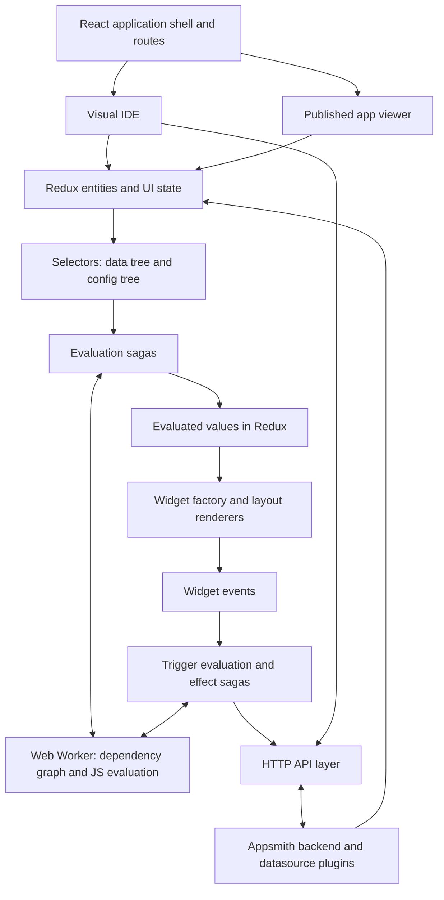

# Appsmith frontend architecture

Source snapshot: `release` at `c3603f0b5c8adf5934a57ac25998981290cadfe7`, dated September 25, 2026. Repository: [appsmithorg/appsmith](https://github.com/appsmithorg/appsmith). Local checkout: `C:\Users\alexb\Desktop\asmith`. This is a full Git clone, not a shallow clone.

This report describes the checked-out implementation. It is a source review: dependencies were not installed, and the application, build, and tests were not run. Observations about tradeoffs are architectural interpretations, not measured performance results or a security audit.

## 1. What the frontend actually is

Appsmith combines three substantial applications within one browser frontend:

1. **The platform shell:** authentication, workspaces, application lists, templates, settings, sharing, and Git interfaces.
2. **The visual IDE:** a widget canvas, property editor, query editor, JavaScript editor, datasource configuration, debugging, and publishing.
3. **The application runtime:** it loads a saved application definition, evaluates bindings and event handlers, executes actions, and renders widgets for end users.

The defining architectural choice is that a user-built app is represented as serialized configuration and code expressions. The browser interprets this definition using a shared React widget library and evaluation engine. Publishing uses a backend publish operation and the shared viewer; this frontend flow does not generate a separate React source project for every app.

The arrows summarize responsibility and data flow, rather than every individual function call. The evaluation worker and the service worker are different subsystems.

## 2. Repository and frontend map

The browser app lives in `app/client`. The repository also contains `app/server`, `app/util`, deployment resources, and contribution documentation. The frontend package manager root is `app/client`, not the Git root.

| Location under `app/client` | Responsibility |
|---|---|
| `src/index.tsx`, `src/store.ts` | Browser bootstrap and global Redux store |
| `src/pages/AppIDE`, `src/IDE` | App editor composition and reusable IDE structures |
| `src/pages/Editor` | Canvas, property pane, JS editor, and established editor features |
| `src/pages/AppViewer` | Published-app presentation |
| `src/widgets`, `src/WidgetProvider` | Widget implementations, registration, configuration, and rendering |
| `src/layoutSystems`, `src/reflow` | Positioning, responsive layout, drag/resize, and reflow |
| `src/actions`, `src/reducers`, `src/selectors`, `src/sagas` | State transitions, derived state, and orchestration |
| `src/entities` | Domain types, data-tree builders, application engines |
| `src/workers` | JavaScript evaluation and related worker infrastructure |
| `src/api` | HTTP transports, service APIs, interceptors |
| `src/PluginActionEditor`, `src/Datasource` | Query/action editing and datasource UI |
| `src/ce`, `src/ee` | Community implementation and edition extension surface |
| `src/git`, `src/git-artifact-helpers` | Modular Git state, UI, and app-specific integration |
| `src/components`, `src/hooks`, `src/utils` | Shared UI and utilities |
| `src/instrumentation` | Browser telemetry and tracing |
| `packages` | Shared source libraries, design systems, tooling, and some Node services |
| `config`, `scripts`, `public` | Owned build configuration, commands, HTML, static assets |
| `cypress`, `playwright`, `test` | E2E suites and test infrastructure |

This is a mixed organizational structure: older code groups files by technical role, while newer modules group related UI, state, and helpers by feature. Expect to follow imports across both styles.

## 3. Technology stack and build

The main frontend is a client-rendered React SPA with an owned, Create React App-derived Webpack toolchain. Its executable build configuration is checked into the repository.

| Layer | Version resolved in this checkout / implementation |
|---|---|
| React and React DOM | 17.0.2; bootstrap uses `ReactDOM.render` |
| TypeScript | 5.5.4 |
| Routing | React Router DOM 5.2.0 |
| State | Redux 4.2.1, React Redux 7.2.4, Redux Saga 1.1.3 |
| Additional state tooling | Redux Toolkit in newer modules; Reselect for derived state |
| Main bundler | Webpack 5.104.1, Babel, webpack-dev-server |
| Styling | styled-components, CSS/themes, Tailwind, legacy Blueprint; design-system-specific tools |
| Code editing | CodeMirror 5, Tern, AST tooling and linting infrastructure |
| Network | Axios-based APIs and interceptors |
| Package management | Yarn 3.5.1 workspaces, `node-modules` linker |
| Node requirement | `.nvmrc`: 24.14.1; package engine: `^24.14.1` |

Versions above come from the lockfile, not just dependency ranges. For example, Webpack's declared range is overridden by a resolution. See [package.json](C:/Users/alexb/Desktop/asmith/app/client/package.json:8), [yarn.lock](C:/Users/alexb/Desktop/asmith/app/client/yarn.lock), and [Webpack entry/configuration](C:/Users/alexb/Desktop/asmith/app/client/config/webpack.config.js:200).

Webpack transpiles both application and workspace source. Many workspace packages expose TypeScript source, so their boundaries organize code reuse within the browser build. They are not separately deployed browser applications. The build includes filesystem caching, hashed assets, dynamic chunks, chunk-load retries, compression, and service-worker generation. Vite is used by Storybook; the main app is built with Webpack.

## 4. Bootstrap, routes, and page loading

[src/index.tsx](C:/Users/alexb/Desktop/asmith/app/client/src/index.tsx:1) first starts route-chunk preloading, creates the evaluation-worker infrastructure, and registers widget loaders. It then starts saga middleware, initializes basic application behavior, loads instrumentation, and mounts React.

The provider stack contains Redux, layering context, styled-components theming, toast/global styles, and error boundaries. The entry imports the router through `ee/AppRouter`; in this clone it forwards to [ce/AppRouter.tsx](C:/Users/alexb/Desktop/asmith/app/client/src/ce/AppRouter.tsx:75).

Routes cover the platform shell, builder, published viewer, and custom-widget editor. The builder and viewer have separate dynamically imported route components. Their loaders can begin initialization while their JavaScript chunks are downloading.

Opening an app follows this broad sequence:

1. Route initialization selects edit or published mode.
2. `AppEngineFactory` chooses `AppEditorEngine` or `AppViewerEngine`.
3. Engine setup establishes app mode and starts evaluation infrastructure.
4. A consolidated backend request loads the initial app/page context.
5. Application and page identity are established, including URL/branch handling.
6. Entity-specific actions populate Redux from the consolidated response.
7. Widgets, evaluation, and page-load actions become ready; the mode-specific engine completes initialization.

The consolidated APIs are `/api/v1/consolidated-api/edit` and `/api/v1/consolidated-api/view`. Their response bundles include user/config/feature information, page data, actions, JS collections, themes, and custom libraries; edit mode additionally needs editor resources such as datasource and plugin configuration.

Sources: [InitSagas](C:/Users/alexb/Desktop/asmith/app/client/src/sagas/InitSagas.ts:350), [engine factory](C:/Users/alexb/Desktop/asmith/app/client/src/entities/Engine/factory.ts:1), [editor engine](C:/Users/alexb/Desktop/asmith/app/client/src/entities/Engine/AppEditorEngine.ts:135), [viewer engine](C:/Users/alexb/Desktop/asmith/app/client/src/entities/Engine/AppViewerEngine.ts:111), [consolidated API URL builder](C:/Users/alexb/Desktop/asmith/app/client/src/api/services/ConsolidatedPageLoadApi/url.ts:4).

## 5. State management and domain model

[store.ts](C:/Users/alexb/Desktop/asmith/app/client/src/store.ts:30) creates a conventional Redux store with batching, saga middleware, edition middleware, route middleware, and a Sentry enhancer. Most asynchronous workflows are generators managed by Redux Saga. The root saga registers many feature watchers and includes error reporting/restart handling.

The most important state separation is between **saved definitions**, **temporary interaction state**, and **evaluated results**.

| State area | Meaning |
|---|---|
| `entities` | Widget definitions/structure, actions and their data, datasources, plugins, pages, JS objects, runtime widget metadata |
| `ui` | Selection, panes, drag/resize, editor/viewer status, debugging, navigation, application list state |
| `evaluations` | Evaluated values, dependencies, loading entities, form/trigger evaluation, first-evaluation status |
| `form` | Redux Form state |
| `settings`, `organization` | Instance and organization configuration |
| `linting` | Code diagnostics |
| `git` | Newer modular Git state |
| `aiAssistant` | Assistant feature state |

See [root state definition](C:/Users/alexb/Desktop/asmith/app/client/src/ce/reducers/index.tsx:94). The boundary is pragmatic: some domain-like information, such as current application information, also lives under `ui`.

Domain vocabulary matters:

- An **application** contains pages and app-level settings.
- A **page** has a serialized widget/layout definition, often called the **DSL**.
- A **widget** has identity, type, properties, bindings, layout information, and potentially children.
- A **datasource** describes a connection. A **plugin** provides the connector type/configuration. An **action** is a particular query or request using that connection.
- A **JS collection/object** contains user-authored functions and variables.
- **Widget metadata** captures transient values such as typing or row selection separately from design-time configuration.

Selectors combine these slices and avoid making components understand the entire store. Reselect memoization is central. Newer modules use Redux Toolkit, but the overall architecture remains Redux plus sagas. Even names can reflect older implementations: `createImmerReducer` currently uses `mutative` internally, as shown in [ReducerUtils](C:/Users/alexb/Desktop/asmith/app/client/src/utils/ReducerUtils.ts:1).

## 6. Editor composition

[AppIDE.tsx](C:/Users/alexb/Desktop/asmith/app/client/src/pages/AppIDE/AppIDE.tsx:1) manages editor lifecycle, page/branch changes, widget initialization, editor readiness, keyboard shortcuts, and modal/context wrappers.

The shell composes sidebar, left explorer/data pane, central editor, right property pane, and bottom/debugging tools. Pane content is route-aware. The central area can show the widget canvas or another editor; the right pane provides widget properties on relevant canvas routes. Static and animated shell layouts coexist behind a feature flag. See [StaticLayout](C:/Users/alexb/Desktop/asmith/app/client/src/pages/AppIDE/layouts/StaticLayout.tsx:40) and [layout selection](C:/Users/alexb/Desktop/asmith/app/client/src/pages/AppIDE/layouts/index.tsx:23).

Query editing has a composable module in [PluginActionEditor](C:/Users/alexb/Desktop/asmith/app/client/src/PluginActionEditor/PluginActionEditor.tsx:26). It selects the action, datasource, plugin, configuration, and response from Redux, then provides them through context. Toolbar, configuration form, and response/debug panes can be composed around that context. Plugin configuration helps drive the forms, rather than requiring an entirely separate UI for every connector.

## 7. Widgets, rendering, and layout

Widgets have two related layers: the Appsmith integration layer (type, defaults, property definitions, events, validation, layout) and the visible React control. A design-system Button alone is not a complete Appsmith widget.

`src/widgets/index.ts` declares dynamic imports for widget types. [registry.ts](C:/Users/alexb/Desktop/asmith/app/client/src/widgets/registry.ts:6) stores loader functions and caches loaded classes. This indirection is deliberate: evaluation and editor code can request a widget without statically importing the entire widget dependency graph and creating cycles.

The WidgetFactory builds registered widget implementations with wrappers for evaluated props, lazy rendering, layout behavior, and optional metadata. Widget classes derive from BaseWidget and supply mode-specific rendering and configuration. A page's DSL therefore resolves to registered widget types and React elements at runtime.

The concrete render path is page DSL → flattened widget map → root canvas structure → layout-specific CanvasFactory → child widget factory → hydrated props/wrappers → BaseWidget subclass → presentational React component. [withWidgetProps](C:/Users/alexb/Desktop/asmith/app/client/src/widgets/withWidgetProps.tsx:57) merges raw definitions, evaluated values, metadata, loading/selection state, dimensions, and child structure. [MetaHOC](C:/Users/alexb/Desktop/asmith/app/client/src/widgets/MetaHOC.tsx:48) manages runtime widget state. [withLazyRender](C:/Users/alexb/Desktop/asmith/app/client/src/widgets/withLazyRender.tsx:7) can defer content using visibility and idle callbacks.

Dynamic imports do not mean the editor downloads only widgets already on the current page: [editorInitializer](C:/Users/alexb/Desktop/asmith/app/client/src/utils/editor/EditorUtils.ts:6) loads and registers all widget types. The evaluation initialization path separately loads missing types used by the current page. See [WidgetFactory](C:/Users/alexb/Desktop/asmith/app/client/src/WidgetProvider/factory/index.tsx:187), [BaseWidget contract](C:/Users/alexb/Desktop/asmith/app/client/src/widgets/BaseWidget.tsx:79), and [CanvasFactory](C:/Users/alexb/Desktop/asmith/app/client/src/layoutSystems/CanvasFactory.tsx:19).

**The property pane is schema-driven.** Each widget supplies content/style sections, property paths, control types, validation, visibility conditions, dependencies, and binding/JS-mode capabilities. PropertyControlsGenerator renders these definitions, and PropertyControlFactory resolves control types, including switching to code editing when appropriate. Updates dispatch property actions into widget-operation sagas. The same widget metadata also supports the palette, evaluator, autocomplete, setter APIs, and theming. Sources: [PropertyPaneView](C:/Users/alexb/Desktop/asmith/app/client/src/pages/Editor/PropertyPane/PropertyPaneView.tsx:321), [PropertyControlFactory](C:/Users/alexb/Desktop/asmith/app/client/src/utils/PropertyControlFactory.tsx:24), [property update logic](C:/Users/alexb/Desktop/asmith/app/client/src/sagas/WidgetOperationSagas.tsx:805).

Three layout implementations exist:

| Layout | Architectural role |
|---|---|
| Fixed | Grid/position-based layout and drag/resize behavior |
| Auto | Responsive flow/reflow behavior |
| Anvil | A separate structured layout implementation and widget integration |

Editor wrappers include selection and manipulation affordances; viewer wrappers render the application without those editor controls. Auto-height and reflow add further coordination between measurement, layout state, and rendering.

Availability is conditional. [layoutSystemSelectors.ts](C:/Users/alexb/Desktop/asmith/app/client/src/selectors/layoutSystemSelectors.ts:20) currently requires the Anvil or AI-agent feature flag for an ANVIL app to resolve to Anvil; otherwise it falls back to FIXED. The existence of a layout directory does not mean it is enabled for every deployment.

## 8. Reactive JavaScript evaluation

This is the core of Appsmith's low-code behavior. An expression such as `{{GetUsers.data}}` is interpreted in an application namespace assembled from widgets, actions, JS objects, and the `appsmith` context.

[getUnevaluatedDataTree](C:/Users/alexb/Desktop/asmith/app/client/src/selectors/dataTreeSelectors.ts:146) combines these entities. The [data-tree factory](C:/Users/alexb/Desktop/asmith/app/client/src/entities/DataTree/dataTreeFactory.ts:24) also builds a **config tree** containing evaluation metadata: binding paths, triggers, derived properties, validation, and dependencies. User-visible values and evaluator metadata are distinct.

[EvaluationsSaga](C:/Users/alexb/Desktop/asmith/app/client/src/sagas/EvaluationsSaga.ts:353) sends trees and contextual information to a module [Web Worker](C:/Users/alexb/Desktop/asmith/app/client/src/utils/workerInstances.ts:3). The worker owns a long-lived [DataTreeEvaluator](C:/Users/alexb/Desktop/asmith/app/client/src/workers/common/DataTreeEvaluator/index.ts:168).

For an initial evaluation, the evaluator parses JS objects, extracts references using shared AST tooling, builds a dependency graph, sorts it topologically, then evaluates and validates values in dependency order. Cycles produce explicit errors. For updates, it compares previous and current inputs, adjusts dependencies, and evaluates affected dependents. An unchanged tree can exit early.

For example, if a text widget references `{{Input1.text}}`, typing changes input metadata, which changes the unevaluated data tree. The dependency engine recomputes the dependent value. The saga applies worker results to Redux, and the widget's selected props update. This dependency propagation is separate from React reconciliation.

The worker sends a full initial tree and optimized changes for subsequent updates. [treeReducer.ts](C:/Users/alexb/Desktop/asmith/app/client/src/reducers/evaluationReducers/treeReducer.ts:12) applies these updates. Evaluation buffering also consolidates incoming changes while an evaluation is running.

**Display bindings and event handlers have different semantics.** Data/display expressions are synchronous; Promise results are rejected. Event handlers are evaluated asynchronously and support awaiting effects. A single expression may produce a native value such as an array; mixed literal text and expressions use substitution rules. See [synchronous evaluation](C:/Users/alexb/Desktop/asmith/app/client/src/workers/Evaluation/evaluate.ts:369) and [async evaluation](C:/Users/alexb/Desktop/asmith/app/client/src/workers/Evaluation/evaluate.ts:466).

The worker provides an execution environment and moves work off the UI thread. That alone is not a complete security-sandbox guarantee. It removes or wraps selected APIs and supplies platform functions; async `fetch` is available with credentials omitted. Browser isolation and backend authorization remain distinct concerns.

## 9. Events, queries, and backend communication

Consider a button handler containing `{{GetUsers.run()}}`:

1. The widget dispatches an execution request with event/source context.
2. An execution saga requests asynchronous trigger evaluation in the worker.
3. `GetUsers.run()` creates a typed platform effect request.
4. The worker sends that request to the main thread and waits for its result.
5. Main-thread sagas route the request to plugin-action execution.
6. Parameters are evaluated and sent through `ActionAPI` to `/api/v1/actions/execute`.
7. The backend executes the configured plugin action.
8. The response updates Redux and the runtime data tree. Dependent widgets update, and the worker's awaited call resolves.

Sources: [effect routing](C:/Users/alexb/Desktop/asmith/app/client/src/ce/sagas/ActionExecution/ActionExecutionSagas.ts:63), [worker action functions](C:/Users/alexb/Desktop/asmith/app/client/src/workers/Evaluation/fns/actionFns.ts:5), [worker/main-thread bridge](C:/Users/alexb/Desktop/asmith/app/client/src/sagas/EvalWorkerActionSagas.ts:102), [plugin execution](C:/Users/alexb/Desktop/asmith/app/client/src/sagas/ActionExecution/PluginActionSaga.ts:1330), [HTTP execution endpoint](C:/Users/alexb/Desktop/asmith/app/client/src/api/ActionAPI.tsx:263).

Other platform effects, including navigation, modals, alerts, downloads, clipboard, and storage, use the same general typed-effect routing approach with their own handlers. Binding evaluation and user JS run in the browser; configured datasource queries are mediated by the backend. User-authored async fetch is a separate capability.

Two API styles coexist: the older static [Api class](C:/Users/alexb/Desktop/asmith/app/client/src/api/Api.ts:13) and newer [apiFactory/service APIs](C:/Users/alexb/Desktop/asmith/app/client/src/api/core/factory.ts:7). Both use Axios and shared interceptors. The transport uses `/api/` and credentials, while request interceptors add version, Git-branch, environment, anonymous-user, and monitoring context. Response handling centralizes offline, timeout, authorization, and backend errors. Follow the conventions of the feature being changed rather than assuming a single API abstraction throughout.

## 10. Saving, publishing, and the viewer

Editing modifies the draft widget definition in Redux. Layout persistence reconstructs the nested DSL and sends it to the page API. The save watcher debounces `SAVE_PAGE_INIT` by 500 milliseconds. This persistence flow is different from frequent runtime metadata updates such as typing into an input.

Saved DSL evolves across releases. The shared DSL package provides flattening/nesting and versioned migrations; this snapshot's migration constant is 94. Persisted widget-property changes therefore require attention to compatibility and migration, not just component rendering.

Sources: [save watcher](C:/Users/alexb/Desktop/asmith/app/client/src/ee/sagas/PageSagas.tsx:53), [page API](C:/Users/alexb/Desktop/asmith/app/client/src/api/PageApi.tsx:209), [DSL migrations](C:/Users/alexb/Desktop/asmith/app/client/packages/dsl/src/migrate/index.ts:97).

More precisely, `UPDATE_LAYOUT` updates the widget map and triggers save orchestration. The save request is gated to edit mode outside preview and checks management permissions. The payload helper uses `nestDSL`, then the API PUTs the definition to `v1/layouts/{layoutId}/pages/{pageId}` with application context. Existing page-update requests can be cancelled. On load, DSL extraction can run shared migrations and apply a layout-specific transformer before flattening. See [save gating](C:/Users/alexb/Desktop/asmith/app/client/src/ce/sagas/PageSagas.tsx:675), [payload construction](C:/Users/alexb/Desktop/asmith/app/client/src/ce/sagas/helpers.ts:102), and [DSL extraction](C:/Users/alexb/Desktop/asmith/app/client/src/utils/WidgetPropsUtils.tsx:48).

Publishing calls the application publish endpoint and then opens/refocuses the viewer URL. See [publish saga](C:/Users/alexb/Desktop/asmith/app/client/src/ce/sagas/ApplicationSagas.tsx:131) and [publish API](C:/Users/alexb/Desktop/asmith/app/client/src/ce/api/ApplicationApi.tsx:300).

The viewer loads published actions and JS collections, while the editor loads draft entities and editing resources. Both share widgets and evaluation machinery. Published action execution sets `viewMode`; it does not bypass the backend. Editor-specific work includes JS-definition updates, diagnostics, and autocomplete. Some library initialization is deferred in the viewer, and persistent dependency-computation caches are feature-gated for published mode.

## 11. Shared packages and design systems

| Package group | Purpose |
|---|---|
| `@appsmith/ads`, `@appsmith/ads-old` | Platform/editor UI components, including a retained older generation |
| `@appsmith/wds`, `@design-system/widgets-old` | Widget-facing controls, including older controls still in use |
| `@appsmith/wds-headless`, `@appsmith/wds-theming` | Shared behavior, theme tokens, color utilities and styling support |
| `appsmith-icons` | Icon assets and generation |
| `@design-system/storybook` | Component explorer and visual/accessibility test tooling |
| `@shared/ast` | Parsing, reference extraction, refactoring, and JS-object tooling |
| `@shared/dsl` | Serialized widget-tree utilities and migrations |
| `@appsmith/utils`, `@appsmith/eslint-plugin` | Shared utilities and repository-specific lint rules |
| `appsmith-rts` | A Node/Express supporting service, not the browser evaluation worker |
| `appsmith-mcp` | A separate Node MCP service, not browser UI |

There are 14 package manifests beneath `packages`. Browser TypeScript configuration excludes RTS and MCP. Their placement in the workspace enables shared dependencies/source tooling without making them browser components.

ADS styles the builder/platform. WDS styles the widgets used inside user-built applications. WDS has its own theming and explicitly prevents platform typography from leaking into widgets. Some WDS controls use Emotion/CSS modules and React Aria; ADS and older code use other styling primitives. Both old and new packages have live consumers. This is evidence of coexisting generations, not evidence of a fully completed migration or a promised roadmap.

Sources: [ADS manifest](C:/Users/alexb/Desktop/asmith/app/client/packages/design-system/ads/package.json:4), [WDS manifest](C:/Users/alexb/Desktop/asmith/app/client/packages/design-system/widgets/package.json:19), [WDS theme isolation](C:/Users/alexb/Desktop/asmith/app/client/packages/design-system/theming/src/theme/src/ThemeProvider.tsx:40), [browser exclusions](C:/Users/alexb/Desktop/asmith/app/client/tsconfig.json:44).

## 12. Community and enterprise extension surface

Ordinary consumers generally import edition-sensitive functionality through `ee/...`. In this public clone, many `src/ee` files forward to implementations under `src/ce`. For example, [ee/AppRouter.tsx](C:/Users/alexb/Desktop/asmith/app/client/src/ee/AppRouter.tsx:1) re-exports the community router, and the EE reducer entry combines the CE reducer map.

This adds a replaceable edition boundary without scattering all edition decisions through components. The presence of an `ee` import does not establish that a particular commercial implementation is present in this public checkout. Follow the forwarding file to see what actually executes.

The `src/enterprise/README.md` explains the historical extension intent but refers to an override directory that is not the active implementation layout here. Current paths are `src/ce` and `src/ee`, with `ee/*` resolved by the TypeScript path configuration and source modules. Some newer features are explicitly CE-owned exceptions to the usual import convention.

## 13. Performance, errors, and observability

Several mechanisms address different bottlenecks:

- **Loading:** separate editor/viewer chunks, route-aware preload hints, widget dynamic imports, and retries for chunk loading.
- **Initialization:** consolidated API responses and service-worker API prefetch reduce serial startup work.
- **CPU:** binding evaluation happens in a worker; dependency tracking and incremental updates limit recomputation.
- **Rendering/state:** memoized selectors, batching, lazy widget wrappers, and diffs reduce unnecessary work.
- **Published apps:** conditional persistent computation caching reuses graph/path calculations.

The [service worker](C:/Users/alexb/Desktop/asmith/app/client/src/serviceWorker.ts:24) prefetches relevant APIs on document navigation and can serve the prefetched response. Its source explicitly removes an old static precache and delegates static-file caching to HTTP cache headers. These mechanisms do not establish complete offline app support.

The UI uses error boundaries, safe-crash routing, debugger state, binding/validation errors, and centralized API failure handlers. Instrumentation includes Sentry and Grafana Faro/OpenTelemetry, with tracing controlled by configuration. See [instrumentation](C:/Users/alexb/Desktop/asmith/app/client/src/instrumentation/index.ts:68) and [API failure handling](C:/Users/alexb/Desktop/asmith/app/client/src/api/interceptors/response/apiFailureResponseInterceptor.ts:6).

Runtime configuration combines build-time environment variables and injected `window.APPSMITH_FEATURE_CONFIGS`; feature flags also arrive from backend initialization. That means the checked-out code alone cannot tell you which conditional features a particular deployment exposes. See [configuration resolution](C:/Users/alexb/Desktop/asmith/app/client/src/ce/configs/index.ts:150).

## 14. Testing and local development

The repository has multiple complementary test layers:

| Tool | Coverage / command from `app/client` |
|---|---|
| TypeScript | `yarn check-types` |
| Jest + Testing Library | `yarn test:unit`; watch mode: `yarn test:jest` |
| Workspace unit tests | `yarn test:unit:ci` |
| Cypress | `yarn test` invokes the Cypress shell runner |
| Playwright | `yarn test:pw`; focused project: `yarn test:pw:smoke` |
| Storybook/Chromatic/a11y tooling | `yarn storybook`, with package-specific testing commands |
| Lint and formatting | `yarn lint`, `yarn prettier`; workspace variants end in `:ci` |

Jest uses jsdom and mocks for browser-specific dependencies, styles, canvas, and workers. E2E suites depend on an accessible Appsmith deployment and their setup/authentication configuration. Both Cypress and Playwright configurations default to `dev.appsmith.com` unless configured otherwise; do not assume a default test command targets an arbitrary local server.

The scripts expose `yarn start`, `yarn build`, and `yarn generate:widget`. The development server defaults to port 3000, but a complete environment also needs backend/proxy configuration. The production shell script gives Node up to a 16 GB heap; that is a configured upper limit, not a measured minimum memory requirement.

For this Windows checkout, the repository's [ClientSetup guide](C:/Users/alexb/Desktop/asmith/contributions/ClientSetup.md:202) documents WSL2 and Docker Desktop, and recommends working from the WSL filesystem. Several scripts use Bash/Unix environment assignment, so ordinary PowerShell execution of package scripts is not the documented complete development path.

A practical setup sequence is: use the required Node/Yarn versions in WSL, install workspace dependencies from `app/client`, configure a backend and the documented Nginx/proxy/hostname setup, then run the frontend. The existing `start-https.sh` supports Docker/native Nginx and HTTP/HTTPS options. No installation or machine configuration was performed as part of this architecture review.

Sources: [scripts](C:/Users/alexb/Desktop/asmith/app/client/package.json:17), [Jest configuration](C:/Users/alexb/Desktop/asmith/app/client/jest.config.js:9), [Playwright configuration](C:/Users/alexb/Desktop/asmith/app/client/playwright.config.ts:8), [local setup](C:/Users/alexb/Desktop/asmith/contributions/ClientSetup.md), [proxy helper](C:/Users/alexb/Desktop/asmith/app/client/start-https.sh:15).

## 15. Extension paths and custom widgets

Adding a built-in widget to the repository means implementing the BaseWidget contract, presentation, defaults, validation/bindings, property-pane schemas, events, and relevant layout behavior, then registering a loader. `yarn generate:widget` provides scaffolding. A compact conventional example is [ButtonWidget](C:/Users/alexb/Desktop/asmith/app/client/src/widgets/ButtonWidget/widget/index.tsx:42). The newer [WDSButtonWidget](C:/Users/alexb/Desktop/asmith/app/client/src/widgets/wds/WDSButtonWidget/widget/index.tsx:14) uses the same contract while splitting configuration into sibling files and consuming WDS presentation. Add tests for behavior and compatibility appropriate to the change; a persisted-schema change may require a DSL migration.

An in-app **custom widget** is a different extension mechanism. User HTML/CSS/JS is assembled into an iframe's `srcDoc`. A message bridge exposes `appsmith.onReady`, `onModelChange`, `updateModel`, and `triggerEvent`. Model changes integrate with widget metadata; named events enter the normal action-execution pipeline.

The host checks that received messages come from that iframe's window. The standard sandbox permits scripts without `allow-same-origin`; deployment configuration can disable the sandbox. WDS has a related implementation using IframeMessenger. This is an iframe/model/event boundary, not direct access to the editor's React component tree. Sources: [classic iframe implementation](C:/Users/alexb/Desktop/asmith/app/client/src/widgets/CustomWidget/component/index.tsx:76), [bridge API](C:/Users/alexb/Desktop/asmith/app/client/src/widgets/CustomWidget/component/customWidgetscript.js:240), [event execution integration](C:/Users/alexb/Desktop/asmith/app/client/src/widgets/CustomWidget/widget/index.tsx:403).

Property-control extensions belong in the property-control registry/library. Layout behavior belongs in the relevant layout system. Connector UI changes involve plugin configuration and the action editor, while connector execution also requires backend work. Selecting the correct extension layer avoids embedding platform behavior inside a presentational component.

## 16. How to approach changes and debugging

| Intended change or symptom | Start here | Then trace |
|---|---|---|
| App fails during initial loading | `sagas/InitSagas.ts`, `entities/Engine` | Consolidated response, readiness actions, mode-specific engine |
| Wrong widget value | `selectors/dataTreeSelectors.ts`, `sagas/EvaluationsSaga.ts` | Input metadata, binding config, dependency graph, evaluated result |
| Button/query event fails | `ce/sagas/ActionExecution`, `sagas/ActionExecution/PluginActionSaga.ts` | Worker effect bridge, evaluated parameters, backend response |
| Widget appearance or behavior | Relevant `src/widgets/<Widget>` | Config/property pane, BaseWidget wrappers, shared control package |
| Canvas positioning | `layoutSystems`, `reflow` | Selected layout mode, editor/viewer wrapper, measurement metadata |
| Property does not persist | Property update saga and `PageSagas` | Saved widget definition, nested DSL, page API |
| New persisted property breaks old apps | Widget config and `packages/dsl` | Defaults, versioned migration, evaluation paths |
| Editor pane/routing change | `pages/AppIDE/layouts`, `IDE` | Pane routers, selectors, feature flags |
| Query editor form change | `PluginActionEditor` | Plugin form configuration, action context, datasource |
| Shared builder UI change | `packages/design-system/ads` | Existing consumers and Storybook |
| Shared runtime control change | WDS or the legacy widget-control package used by that widget | Appsmith widget wrapper, theming, property integration |
| Edition-dependent behavior | The imported `ee/...` module | Its CE forwarding target and deployment feature flags |

My architectural assessment: the strong boundaries are between saved definitions and evaluated values, between main-thread UI and worker computation, and between platform UI and user-app widget presentation. These enable the same runtime to support both building and viewing applications.

The main complexity comes from interactions across those boundaries, numerous long-lived saga workflows, and coexisting generations of state/UI/layout code. A small JSX change can be local; a persisted property or execution change can involve widget configuration, reducers, selectors, worker messages, migration, and backend contracts. Tracing one complete user interaction is therefore more useful than reading components in isolation.

For a first reading pass, follow this order: `index.tsx` → `ce/AppRouter.tsx` → `store.ts` and `ce/reducers/index.tsx` → `InitSagas.ts` and the two AppEngines → one Button widget and WidgetFactory → `dataTreeSelectors.ts` → `EvaluationsSaga.ts` → `DataTreeEvaluator` → plugin execution and page saving. This gives you the shell, state, initialization, rendering, evaluation, effects, and persistence in a connected sequence.
